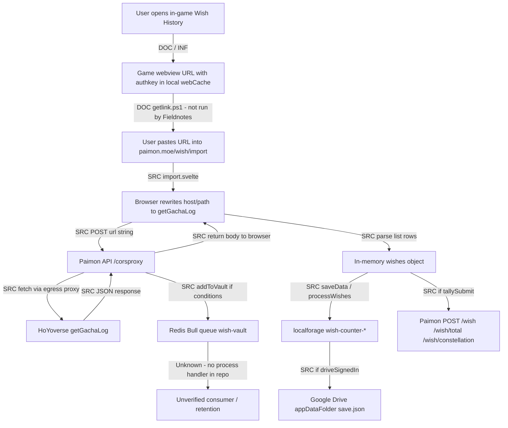

<h1 style="text-align:center">Genshin Impact — API and endpoints</h1>

[ Case overview](README.md) · [ Fieldnotes](../../README.md)

Wish-history and community API landscape, with a **line-cited** Paimon.moe data-flow review (repos verified on default branch `main`, 2026-10-10).

Interfaces that can feed community tools, with live checks from 2026-10-11, are catalogued separately in [Developer features](developer-features.md) and [developer-features.yaml](developer-features.yaml). This page keeps the wish-import data flow.

> **ℹ️ Note**
>
> **Authentication** proves who/what is calling. **Authorisation** limits what that credential may read. Never publish real `authkey`, cookies, or UIDs.
>
> A HoYoverse hostname does **not** make an interface an official public developer API.

**Repository verification**

| Project | Owner | Default branch | Homepage |
| --- | --- | --- | --- |
| <a href="https://github.com/MadeBaruna/paimon-moe" style="color:#c77dff"> MadeBaruna/paimon-moe</a> | MadeBaruna | `main` | https://paimon.moe |
| <a href="https://github.com/MadeBaruna/paimon-moe-api" style="color:#c77dff"> MadeBaruna/paimon-moe-api</a> | MadeBaruna | `main` | (API for paimon.moe) |

Source was read as text only. Dependencies were **not** installed; repository scripts were **not** executed.


<h2 style="text-align:center">Table of contents</h2>

- [A. Official HoYoverse interfaces](#a-official-hoyoverse-interfaces)
- [B. Publicly accessible endpoints](#b-publicly-accessible-endpoints)
- [C. Authenticated APIs](#c-authenticated-apis)
- [D. Internal or undocumented interfaces](#d-internal-or-undocumented-interfaces)
- [Paimon.moe wish-import data flow](#paimonmoe-wish-import-data-flow)
- [corsProxy and addToVault](#corsproxy-and-addtovault)
- [Complete data-storage destinations](#complete-data-storage-destinations)
- [Browser storage (localforage)](#browser-storage-localforage)
- [Google Drive synchronisation](#google-drive-synchronisation)
- [Wish-history access material (authkey) — exposure boundary](#wish-history-access-material-authkey--exposure-boundary)
- [E. Endpoint evidence register](#e-endpoint-evidence-register)
- [Sources](#sources)


<h2 style="text-align:center">A. Official HoYoverse interfaces</h2>

<h3 style="text-align:center">Officially documented developer API (game data)</h3>

| Result | Confidence |
| --- | --- |
| None identified in the reviewed official docs / developer materials (contrast: Discord’s public developer docs) |  Search of public materials — **not** proof that none exists anywhere |

<h3 style="text-align:center">Official service interface — not a third-party developer API</h3>

| Interface | Classification | Notes |
| --- | --- | --- |
| In-game Wish History webview + `getGachaLog` HTTP API | **Official service interface not documented as a third-party developer API** | Used by the game’s own history UI; community tools reuse the URL/`authkey` the webview emits |
| HoYoLAB / HoYoPlay web UIs | Official products | Not open game-data developer APIs |

<h3 style="text-align:center">Wish-history / `getGachaLog` (as constructed by Paimon)</h3>

| Topic | Finding | Evidence |
| --- | --- | --- |
| Host (global) | `public-operation-hk4e-sg.hoyoverse.com` | `import.svelte` L239–240 |
| Host (China) | `public-operation-hk4e.mihoyo.com` | `import.svelte` L242–244 |
| Path | `gacha_info/api/getGachaLog` | `import.svelte` L240 |
| Method | `GET` (via proxied URL string) | Importer posts URL to `/corsproxy`; backend `fetch(url)` |
| Parameters set by importer | `auth_appid=webview_gacha`, `sign_type=2`, `init_type=301`, `lang`, `gacha_type`, `size`, `page`, `end_id`, plus `lang=en-us` append; original query (including `authkey`) retained from pasted URL | `import.svelte` L231–238, L262–263 |
| Response fields used | `retcode`, `message`, `data.list`, `data.region`; list rows use `gacha_type`, `time`, `name`, `item_type`, `uid`, `id` | `import.svelte` L289–371 |
| Expiry signal | `message === 'authkey timeout'` | `import.svelte` L294–296 |

Placeholder (no secrets):

```text
https://public-operation-hk4e-sg.hoyoverse.com/gacha_info/api/getGachaLog?...&authkey=[REDACTED]&gacha_type=301&page=1&size=20&end_id=0
```


<h2 style="text-align:center">B. Publicly accessible endpoints</h2>

| Service | Evidence of unauthenticated access |
| --- | --- |
| genshin.dev (`genshin.jmp.blue`) | README + live `GET /`, `GET /characters` (2026-10-10) and `GET /characters/ayaka?lang=en` (2026-10-11) |
| Project Amber (`gi.yatta.moe`) | Live `GET /api/v2/en/avatar` (2026-10-11). `api.ambr.top` did not resolve |
| Hakushin (`static.nanoka.cc`) | Live manifest and `/gi/7.1.51/character.json` (2026-10-11). `api.hakush.in` did not resolve |
| Enka.Network UID routes | Enka docs. 2026-10-11 checked only `GET /api/uid/0/?info` (HTTP 400). No real UID |
| paimon.moe static site | Public website; wish import still needs a user-supplied history URL |

Detail, samples, and status labels: [Developer features](developer-features.md).

Paimon `/corsproxy` accepts a JSON body `{ url }` with **no auth in schema** (`corsProxy.json`) — that means the *proxy endpoint* is unauthenticated in source, **not** that HoYoverse `getGachaLog` is public without `authkey`.


<h2 style="text-align:center">C. Authenticated APIs</h2>

| Interface | Credential | Notes |
| --- | --- | --- |
| `getGachaLog` | Temporary `authkey` (and related query fields) in URL | Must be present for successful `retcode === 0` |
| HoYoLAB game records | Session cookies | Undocumented for third parties; not tested |
| Paimon Drive sync | Google OAuth (`drive.appdata`) | Optional; user sign-in |
| Paimon `/corsstatus` | `authorization` preHandler | Operator/admin style |
| Optional wish tally POSTs | None in client; body includes `uid` + aggregates | See `wishTally.js` |


<h2 style="text-align:center">D. Internal or undocumented interfaces</h2>

| Class | Label |
| --- | --- |
| HoYoverse `getGachaLog` for third-party reuse | Official service surface; **undocumented as third-party developer API** |
| HoYoLAB `game_record/*` | Internal/unknown (community-documented only) |
| Paimon Redis Bull queue `wish-vault` | Third-party internal; producer in source; **consumer not found in repo** |


<h2 style="text-align:center">Paimon.moe wish-import data flow</h2>

The game does **not** push wish data to Paimon automatically. A **user** must open Wish History, obtain a history URL (community scripts help extract it), paste it into paimon.moe, and start import.

<h3 style="text-align:center">Evidence legend for arrows</h3>

| Tag | Meaning |
| --- | --- |
| **SRC** | Explicit in source |
| **DOC** | Documented by Paimon UI/gists |
| **INF** | Inferred, not verified |
| **LIVE** | Would need a live test (not done) |

<h3 style="text-align:center">Mermaid overview</h3>



<h3 style="text-align:center">Step-by-step (source)</h3>

| Step | What happens | Where | Tag |
| --- | --- | --- | --- |
| 1 | User selects server/platform; pastes `genshinLink` or uses local-text importer | `import.svelte` UI + `startImport` L159–169 | SRC |
| 2 | URL parsed (`new URL(genshinLink)` or regex variants) | `processLogs` L172–184 | SRC |
| 3 | Optional UID check from local save | `checkUID` L716–722 | SRC |
| 4 | For each banner `gacha_type`, call `getLog` | L201–205 | SRC |
| 5 | Mutate URL: set host/path/params; keep original query (incl. `authkey`) | `getLog` L231–244 | SRC |
| 6 | Paginate with `page` / `end_id`; stop when list empty or time ≤ newest local pull | L259–383, `getNewestPullTime` L669–689 | SRC |
| 7 | Each page: `POST { url }` to `${VITE_API_HOST}/corsproxy` with up to 3 retries | L268–278, `fetchRetry` L725–746 | SRC |
| 8 | Backend fetches that URL through an egress HTTP proxy bound per client IP (Redis TTL 3600s) | `corsProxy.ts` L57–62; `proxy.ts` L29–40 | SRC |
| 9 | On success JSON, browser maps rows into `wishes[code]` | L323–368 | SRC |
| 10 | User confirms save → pity calc → `updateSave` to localforage | `saveData` / `processWishes` L386–596 | SRC |
| 11 | Optional `submitWishTally()` (checkbox `tallySubmit`, default **true**) | L119, L404–409; `wishTally.js` | SRC |
| 12 | If Drive signed in, `updateSave` triggers debounced upload | `saveManager.js` L158–165 | SRC |

<h3 style="text-align:center">Pagination, merge, errors</h3>

| Topic | Behaviour | Evidence |
| --- | --- | --- |
| Page size | Default `fetchSize = 20`; anomalous short page + more data triggers `/corsreset` and error | L121, L303–308 |
| Delay | `sleep(1000)` between pages; `sleep(2000)` between banners | L372, L203 |
| Incremental import | Stops at pulls ≤ newest local pull time unless `forceUpdate` | L341–342, L669–673 |
| Merge | Keeps local pulls older than oldest imported pull; concatenates then recalculates pity | `processWishes` L437–465, L596 |
| Force update | Newest-pull cutoff set to year 2000 (import all); offers JSON backup download | L197–198, L670–672 |
| Cancel | `cancelled` flag + `AbortController` | L127, L160–163, L794+ |
| Multi-account | `getAccountPrefix()` prefixes localforage keys | `account.js`; `prefix` L111 |
| Auth errors | `authkey timeout` → expired message | L294–296 |
| UID mismatch | Row `uid` ≠ stored → account error | L335–337 |


<h2 style="text-align:center">corsProxy and addToVault</h2>

**Files:** [`corsProxy.ts`](https://github.com/MadeBaruna/paimon-moe-api/blob/main/src/routes/corsProxy.ts) · [`vault.ts`](https://github.com/MadeBaruna/paimon-moe-api/blob/main/src/queue/vault.ts) · [`proxy.ts`](https://github.com/MadeBaruna/paimon-moe-api/blob/main/src/stores/proxy.ts) · [`index.ts`](https://github.com/MadeBaruna/paimon-moe-api/blob/main/src/index.ts) · [`docker-compose.yml`](https://github.com/MadeBaruna/paimon-moe-api/blob/main/docker-compose.yml)

<h3 style="text-align:center">What `/corsproxy` does (source)</h3>

1. **Invoked by:** browser `POST` with body `{ url: string }` (schema requires only `url`; no auth) — `corsProxy.json`; `corsProxy.ts` L49–57.  
2. **Reads** client IP (`cf-connecting-ip` or `req.ip`), assigns/reuses an egress proxy from `PROXY_LOCATION` via Redis key `proxy:{ip}` (**EX 3600**) — `proxy.ts` L29–40.  
3. **Fetches** `url` with `node-fetch` through that proxy; retries twice (`p-retry`) — `corsProxy.ts` L13–32, L62.  
4. **Returns** upstream JSON/text and status to the browser — L73–75.  
5. **Calls** `void addToVault(url, data)` after a completed fetch attempt (L73), including when HTTP status is non-200.

<h3 style="text-align:center">What `addToVault` does (source)</h3>

```35:46:paimon-moe-api/src/routes/corsProxy.ts
async function addToVault(url: string, data: any): Promise<void> {
  try {
    const u = new URL(url);
    if (u.hostname.endsWith('hoyoverse.com') || u.hostname.endsWith('mihoyo.com')) {
      if (Array.isArray(data?.data?.list)) {
        await vaultQueue.add(data.data.list);
      }
    }
  } catch (err) {
    console.error(err);
  }
}
```

| Question | Answer from source | Confidence |
| --- | --- | --- |
| What invokes it? | `void addToVault(url, data)` on `/corsproxy` handler |  L73 |
| Conditions | Hostname ends with `hoyoverse.com` or `mihoyo.com` **and** `data.data.list` is an array |  L38–40 |
| Data enqueued | **Unmodified** `data.data.list` (HoYoverse wish-row array). No field filter/map in `addToVault` |  L40 |
| Typical list fields (importer uses) | `gacha_type`, `time`, `name`, `item_type`, `uid`, `id` (among others returned by HoYoverse) |  Importer field use L323–368 — list itself is upstream JSON |
| URL / authkey enqueued? | **No** — only the list array is passed to `vaultQueue.add` |  L40 |
| Transform before enqueue | None in reviewed code |  |
| Queue name | Bull queue `'wish-vault'` on `REDIS_URL` (default `redis://localhost:6379`) |  `vault.ts` L3 |
| Job options / Redis TTL on jobs | **`vaultQueue.add` called with one argument** — no job opts, no `removeOnComplete`, no expiry in this call. **No job TTL found in reviewed source** |  L40; `vault.ts` entire file (5 lines) |
| Consumer / worker | **`vault.ts` only constructs and exports the queue** — no `queue.process`. Contrast: `wish.ts` L147 `void queue.process(...)`. `index.ts` L22–27 imports wish/tally/wishTotal/wishSummary/wishConstellation/plausible — **not** `./queue/vault` |  **No consumer found in the source reviewed** |
| Deployment docs | API README / `docker-compose.yml` set `REDIS_URL` for the API service; **no vault-specific consumer, TTL, or retention documented** |  Docs read |
| Part of normal import? | Yes — side effect of `/corsproxy` when conditions match |  |

<h3 style="text-align:center">Claim boundaries (required)</h3>

| Allowed claim | Status |
| --- | --- |
| No consumer found in the source reviewed | ✅ (`vault.ts`, `src/queue/*`, `index.ts` imports) |
| No expiry found in the source reviewed | ✅ (no job opts / TTL on `add`) |
| Evidence that no consumer or expiry exists *anywhere* | ❌ **Not claimable** — private workers or Redis policies out of scope |
| Queued data is permanently retained | ❌ **Not claimable** from absence of a consumer |

| Layer | Statement |
| --- | --- |
| 1. Source can do | Enqueue wish `list` arrays to Redis Bull `wish-vault` |
| 2. Conditions | Host suffix match + `data.data.list` is array |
| 3. Production docs | No vault retention/privacy section found in API README |
| 4. Runtime verified | **Not verified** — no live `/corsproxy` or Redis inspection |
| 5. Unknown | Out-of-repo workers; Redis maxmemory/eviction; who can read jobs; infra logging of the request URL |


<h2 style="text-align:center">Complete data-storage destinations</h2>

| Destination | What data? | Trigger | Optional? | Deletion | Retention | Evidence | Confidence |
| --- | --- | --- | --- | --- | --- | --- | --- |
| Browser `localforage` | Wish counters (`wish-counter-*` with pulls/pity), `wish-uid`, settings, accounts, locale, AR/WL, etc. | User confirms save after import; other UI `updateSave` | Core local feature | `updateSave(key, undefined)` removes item; full wipe paths not fully traced | Until cleared by user/browser | `saveManager.js` L146–173; import `processWishes` |  |
| Google Drive `appDataFolder` / `save.json` | Full localforage JSON dump | Debounced upload when Drive signed in; connect/compare flows | **Yes** — requires Google sign-in + `drive.appdata` | Drive file lifecycle via Google account; conflict modal chooses remote/local | Unknown beyond Google Drive policy | `DataSync.svelte` L18, L240–335; `saveManager.js` L158–165 |  sync path;  Google retention |
| Paimon `/wish`, `/wish/total`, `/wish/constellation` | Aggregates: totals, pity counts, sample/legendary/rare pull tuples, constellation name→count maps, plus **plaintext `uid`** | `submitWishTally()` after save if checkbox on | **Yes**, checkbox `tallySubmit` default **`true`** (L119) | Backend upsert/delete of prior hashed wish rows in Postgres (tally queues) — not full raw history dump | Unknown operational retention | `wishTally.js` L45–154; API `queue/wish.ts` (hashes `uid` with XXHash for `uniqueId`) |  client sends `uid`;  server hashes for storage key |
| Redis Bull `wish-vault` | Raw `data.data.list` pages from HoYoverse responses | `/corsproxy` success path when host/list conditions match | Not user-toggleable in importer | **Unknown** — no consumer/delete logic in reviewed source | **Unknown** — no TTL in reviewed source | `corsProxy.ts` L35–40, L73; `vault.ts` L3 |  enqueue;  fate |
| Redis `proxy:{ip}` | Egress proxy assignment string | Each `/corsproxy` | Internal | `unassignProxy` deletes key; also EX 3600 | 1 hour TTL in source | `proxy.ts` L29–45 |  |
| Plausible visitor queue | Site visitor aggregate (not wish URL) | Cron/hourly queue — **not** on import URL path | Ops env (`PLAUSIBLE_*`) | N/A to wishes | N/A | `queue/plausible.ts` |  separate path |

**Anonymity:** Tally payloads include **`uid`**. Do **not** call tally data anonymous. Server-side XXHash of `uid` for DB keys does not remove the fact that the client transmits `uid` in clear JSON.


<h2 style="text-align:center">Browser storage (localforage)</h2>

**File:** [`paimon-moe/src/stores/saveManager.js`](https://github.com/MadeBaruna/paimon-moe/blob/main/src/stores/saveManager.js)

| Topic | Behaviour | Lines |
| --- | --- | --- |
| Library | `localforage` (IndexedDB/localStorage abstraction) | L4, L153 |
| Write API | `updateSave(key, data)` → `setItem` or `removeItem` if `data === undefined` | L146–156 |
| Read API | `readSave(key)` | L171–173 |
| Startup | `checkLocalSave` migrates legacy `localStorage` → localforage once | L128–136, L74–126 |
| Wish keys | `wish-counter-character-event`, `weapon-event`, `standard`, `beginners` (optionally prefixed per account) | L99–105; import `processWishes` path `wish-counter-${type.id}` |
| Wish structure | `{ total, legendary, rare, pulls, guaranteed?, rateoff? }` | `import.svelte` L564–569 |
| Other keys | `wish-uid`, `wish-counter-setting`, `collectables-updated`, `accounts`, `locale`, `server`, `update-time`, AR/WL, etc. | saveManager migration + import `saveData` |
| Multi-account | Prefix from `getAccountPrefix()` (`''` for main, else `{id}-`) | `account.js` |
| Drive trigger | If `driveSignedIn` and local change → debounced `saveToRemote` (5s) | saveManager L30–32, L163–165 |
| Deletion | `updateSave(key, undefined)` removes item; settings UI has reset/delete account components (not fully re-traced here) | L154–155 |

**Does localforage mean data stays only on-device?** **No.** Same save pipeline can upload to Google Drive and optionally submit tally aggregates to Paimon API.


<h2 style="text-align:center">Google Drive synchronisation</h2>

**Files:** [`DataSync.svelte`](https://github.com/MadeBaruna/paimon-moe/blob/main/src/components/DataSync.svelte) · `saveManager.js` · `dataSync.js`

| Topic | Finding | Evidence |
| --- | --- | --- |
| Still present | Yes | `DataSync.svelte` |
| Scope | `https://www.googleapis.com/auth/drive.appdata` | L18 |
| Discovery | Drive v3 REST | L17 |
| Init | Loads `https://apis.google.com/js/api.js` on mount; `gapi.client.init` with client ID + API key from `VITE_*` | L37–43, L343–352 |
| Sign-in gate | Must be signed in **and** have granted scope; else sign-out + toast | L69–75 |
| Remote object | File named `save.json` in Drive **`appDataFolder`** | L240–273 |
| Payload | Full localforage dump as JSON (`getLocalSaveJson`) | saveManager L138–143; DataSync upload |
| Upload path | `PATCH /upload/drive/v3/files/{id}` media upload | saveManager L39–45; DataSync L329–335 |
| When | After local `updateSave` if signed in (debounced 5s); also create/compare on Drive connect | saveManager L163–165; DataSync `getFiles` |
| Conflict | If remote `update-time` ≠ local → modal choose remote or local | DataSync L205–224; `SyncConflictModal.svelte` |
| Size guard | Remote file size &gt; 50_000_000 → treat as empty/old stub | DataSync L301–304 |
| Explicit enable | User must Google-sign-in and grant `drive.appdata` | SRC |

No OAuth flow was completed, and no Google account was opened.


<h2 style="text-align:center">Wish-history access material (authkey) — exposure boundary</h2>

| Stage | Who receives the URL / params | Evidence | Level |
| --- | --- | --- | --- |
| User paste | Browser memory (`genshinLink`) | `import.svelte` |  SRC |
| Browser console | Full URL via `console.log(url)` | L247 |  SRC |
| Paimon API process | `req.body.url` then `fetch(url)` | `corsProxy.ts` L57, L62 |  SRC |
| Egress HTTP proxy | Upstream request to HoYoverse includes query string | `fetch` via `https-proxy-agent` L16–18 |  SRC (proxy sees request);  what proxy operator logs |
| HoYoverse | Normal authenticated `getGachaLog` fetch | Intended destination |  SRC path |
| `wish-vault` queue | **Does not** receive URL — only `data.data.list` | L40 |  SRC |
| Tally / Drive | Do not receive authkey URL (separate payloads) | `wishTally.js`, `DataSync.svelte` |  SRC |

| Topic | Finding | Confidence |
| --- | --- | --- |
| Role | Query param enabling history read until expiry |  Importer treats `authkey timeout` as expiry (L294–296) |
| Sanitise / redact before POST | **None** in reviewed importer or `/corsproxy` |  |
| App-level request logging | Fastify `logger: { level: 'error' }` — not full request-body logging by default |  `index.ts` L31 |
| Error logging | `console.error(err)` on vault/proxy failures — whether `err` embeds URL is **unknown** |  |
| Third-party APM on this path | Plausible queue is **visitor stats**, not corsproxy URL capture |  `plausible.ts` separate |
| Cloudflare / reverse proxy / egress logs | `cf-connecting-ip` implies edge in front; infra may log URLs |  Plausible (header present); **not verified** |
| Claim of credential “leak” to unauthorised party | **Not made** — intentional transmission to Paimon + HoYoverse is by design of the importer | — |

Absence of explicit URL logging in application source does **not** prove infrastructure or third-party systems never capture it.

`getlink.ps1` was not run, and local logs and caches were not read for a real key.


<h2 style="text-align:center">E. Endpoint evidence register</h2>

Classifications use: **official developer API** · **official service (not third-party API)** · **third-party** · **verified unauthenticated public** · **authenticated** · **internal/undocumented** · **unverified**.

Source-defined ≠ proven live-reachable for authenticated paths.

| Service | Host | Path | Method | Classification | Purpose | Authentication | Data flow | Evidence | Verification | Confidence | Limitations |
| --- | --- | --- | --- | --- | --- | --- | --- | --- | --- | --- | --- |
| HoYoverse | `public-operation-hk4e-sg.hoyoverse.com` | `/gacha_info/api/getGachaLog` | GET | Official service; **not** documented third-party developer API | Paginated wish history | Query `authkey` (+ related) | Req → JSON `data.list` | `import.svelte` L239–312 | Static only |  | Not live-tested; not official public API docs |
| HoYoverse | `public-operation-hk4e.mihoyo.com` | same | GET | Official service (CN) | same | same | same | L242–244 | Static |  | same |
| Paimon.moe API | `${VITE_API_HOST}` | `/corsproxy` | POST | Third-party; schema unauthenticated | Proxy client URL | None in schema | `{url}` → upstream; vault side-effect | `corsProxy.ts` L49–75 | Static (defined in source) |  source | Production hostname from env; **not** live-tested with secrets |
| Paimon.moe API | same | `/corsreset` | GET | Third-party | Unassign egress proxy | None apparent | IP → Redis del | L88–101 | Static |  | Not live-tested |
| Paimon.moe API | same | `/wish`, `/wish/total`, `/wish/constellation` | POST | Third-party | Wish tally ingest | None in client | Aggregates + `uid` | `wishTally.js`; `routes/wish.ts` | Static |  | Optional; default-on checkbox |
| Paimon (Redis) | Redis via `REDIS_URL` | Bull `wish-vault` | queue | Internal third-party | Enqueue wish lists | N/A | `data.data.list` jobs | `vault.ts`; `addToVault` | Static |  enqueue;  consume | **No consumer found in reviewed source**; no job TTL found |
| Google Drive | `www.googleapis.com` | Drive v3 `appDataFolder` / `save.json` | OAuth + PATCH/GET | Third-party (Google) authenticated | Optional full-save sync | OAuth `drive.appdata` | Entire localforage JSON | `DataSync.svelte` | Static |  | Not runtime-tested |
| genshin.dev | `genshin.jmp.blue` | `/`, `/characters` | GET | Verified unauthenticated public | Static game data | None | Type/id lists | Live 2026-10-10 | Safe test |  | Not player account data |
| Enka.Network | `enka.network` | `/api/uid/{uid}/?info` | GET | Third-party documented; unauthenticated for public showcase | Showcase info | None documented | `playerInfo` | Enka docs + prior live on docs example | Safe test |  | Rate limits; UID redacted in Fieldnotes |
| HoYoLAB | `bbs-api-os.hoyolab.com` | `/game_record/genshin/api/*` | HTTP | Internal / undocumented as third-party API | Battle Chronicle style | Cookies | Player records | Community wrappers | Docs only |  | Unverified officially |


<h2 style="text-align:center">Sources</h2>

- [import.svelte](https://github.com/MadeBaruna/paimon-moe/blob/main/src/routes/wish/import.svelte)
- [saveManager.js](https://github.com/MadeBaruna/paimon-moe/blob/main/src/stores/saveManager.js)
- [DataSync.svelte](https://github.com/MadeBaruna/paimon-moe/blob/main/src/components/DataSync.svelte)
- [wishTally.js](https://github.com/MadeBaruna/paimon-moe/blob/main/src/functions/wishTally.js)
- [account.js](https://github.com/MadeBaruna/paimon-moe/blob/main/src/stores/account.js)
- [corsProxy.ts](https://github.com/MadeBaruna/paimon-moe-api/blob/main/src/routes/corsProxy.ts)
- [vault.ts](https://github.com/MadeBaruna/paimon-moe-api/blob/main/src/queue/vault.ts)
- [proxy.ts](https://github.com/MadeBaruna/paimon-moe-api/blob/main/src/stores/proxy.ts)
- [index.ts](https://github.com/MadeBaruna/paimon-moe-api/blob/main/src/index.ts)
- [wish.ts routes](https://github.com/MadeBaruna/paimon-moe-api/blob/main/src/routes/wish.ts)
- [getlink.ps1 gist](https://gist.github.com/MadeBaruna/1d75c1d37d19eca71591ec8a31178235) (documented extractor; not executed)


<h2 style="text-align:center">Related resources</h2>

- [Developer features](developer-features.md)
- [Privacy and telemetry](privacy-and-telemetry.md)
- [Investigation log](investigation-log.md)
- [Discord API notes (contrast)](../discord/api-and-endpoints.md)
